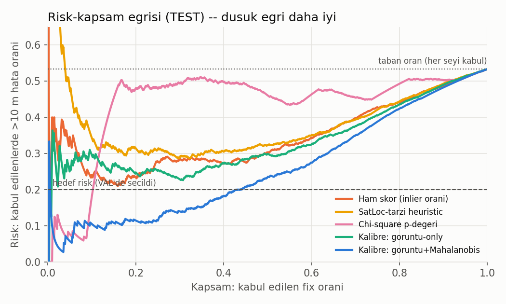
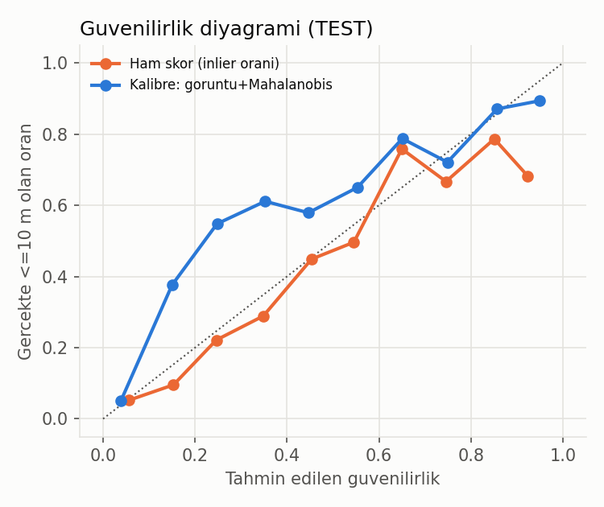
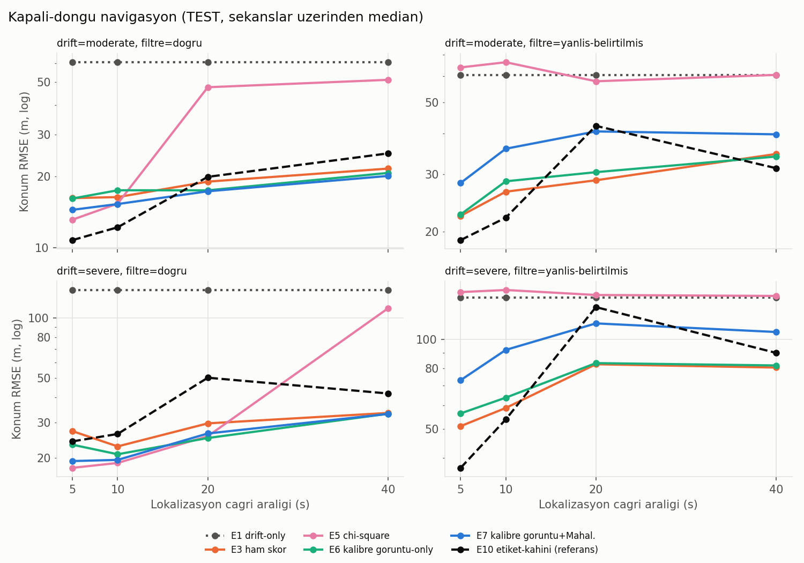
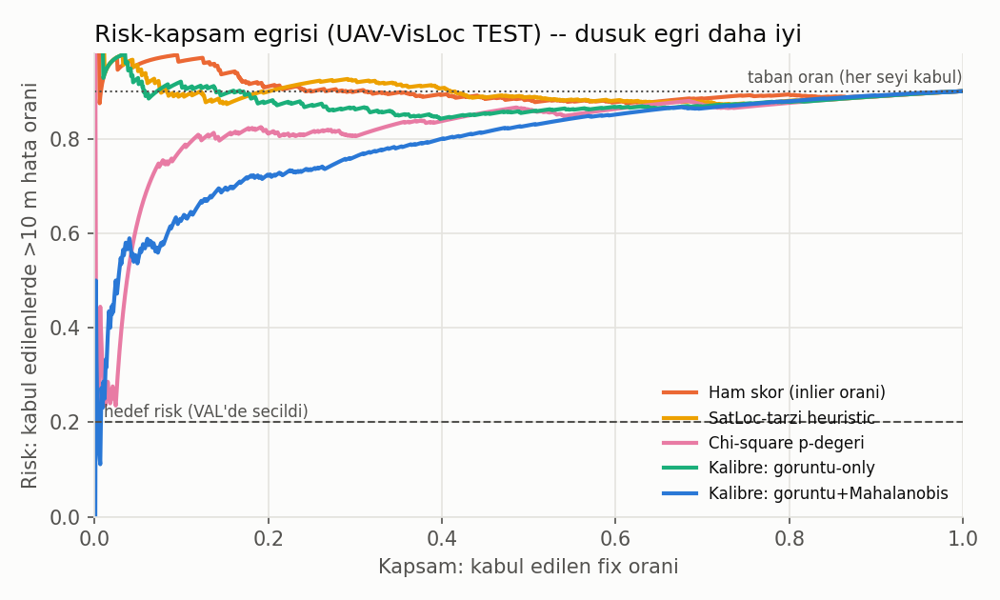
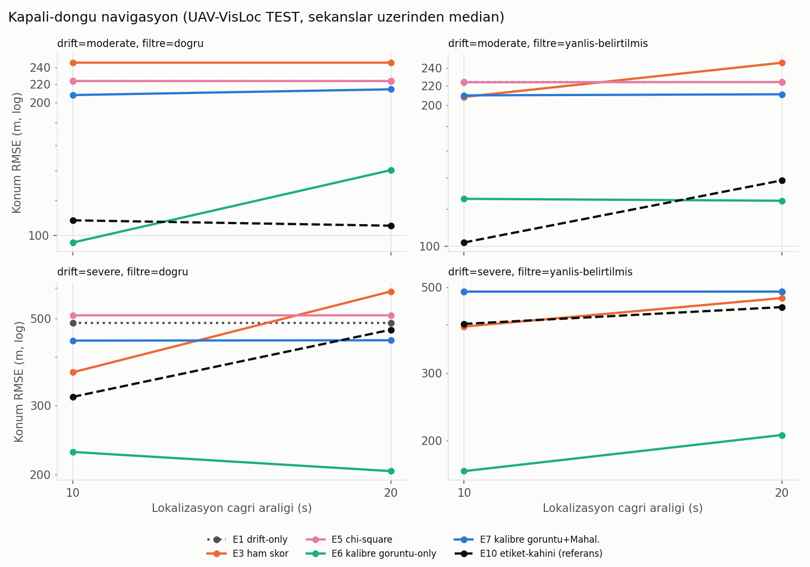
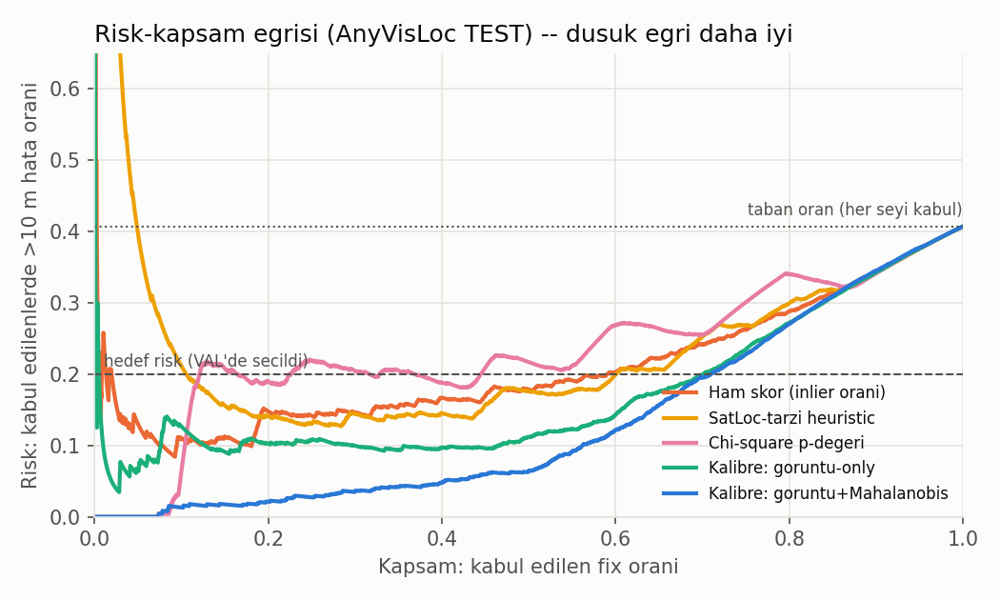

# Calibrated Reliability-Aware RGB Map Relocalization — Sonuç Raporu

**Tarih:** 2026-10-02 · **Donanım:** PC (RTX 4060 Laptop GPU) · **Veri:** AerialVL (VAL bölümü)
**Durum:** M1–M10 ve E1–E11 tamamlandı, TEST bir kez koşuldu. M11 (Jetson) donanım olmadığı için yapılmadı.

---

## 1. Tek paragrafta sonuç

GPS'siz bir İHA'nın kamera görüntüsünü uydu haritasıyla eşleştirip konum bulan bir sistem kuruldu. Bu konuma ne zaman güvenileceğine karar veren **kalibre güvenilirlik modeli**, hiç görülmemiş TEST uçuşlarında doğru ve yanlış fix'leri ham eşleşme skorundan (AUROC 0.78), SatLoc-tarzı sezgisel güvenden (0.76) ve chi-square tutarlılık testinden (0.61) belirgin şekilde daha iyi ayırdı (**AUROC 0.89**). VAL'de seçilen eşik TEST'e taşındığında kalibre model fix'lerin **%37'sini %17 riskle** kabul etti; ham skor ise yalnızca %6'sını %34 riskle kabul edebildi, yani VAL'de verdiği risk sözünü TEST'te tutamadı. Kapalı-döngü navigasyonda kalibre gate, filtrenin kovaryansı doğru olduğunda en düşük hatayı verdi (TEST median RMSE 19.1 m). Kovaryans yanlış belirtildiğinde ise Mahalanobis tabanlı tüm gate'ler (chi-square dahil) doğru fix'leri reddederek çöktü (PDF'in H4/H5 hipotezleri). Bunun çaresi olarak önerilen **REACQUIRE + 2-fix teyidi**, 300 m'lik ani sıçramadan sonra **TEST'teki 12 koşunun tamamında, hiç yanlış kabul yapmadan** 18–21 sn'de kurtardı. Teyitsiz sürüm ise 15 yanlış kabul yaptı.

---

## 2. Ne yapıldı (PDF maddelerine göre)

| Madde | Yapılan | Dosya |
|---|---|---|
| **M1** Veri | AerialVL VAL: 11 sekans, 15.136 kare, 2 coğrafi referanslı harita. Sekans bazlı sabit ayrım: 6 TRAIN, 2 VAL, 3 TEST. | `src/splits.py`, `src/aerialvl_loader.py` |
| **M2** Lokalizasyon | SuperPoint + LightGlue + RANSAC (similarity), çok-ölçekli arama, büyük alanda karolu kaba→ince arama | `src/localization_pipeline.py` |
| **M3** Etiket | fix_error ≤ 10 m güvenli (birincil), ≤ 25 m (ikincil). Sonuçlardan sonra değiştirilmedi. | `src/fix_record.py` |
| **M4** Özellikler | eşleşme/inlier sayısı, inlier oranı, reprojeksiyon hatası, inlier dağılımı, dönüşüm koşul sayısı, top1–top2 farkı, ölçek oranı, Mahalanobis mesafesi | `src/build_fix_dataset.py` |
| **M5** Baseline + kalibrasyon | ham skor, SatLoc-tarzı sezgisel, chi-square, kalibre (logreg/GBM + isotonic) | `src/eval_calibration.py`, `src/reliability_model.py` |
| **M6** Drift simülatörü | sabit sapma, hız/ölçek hatası, rastgele yürüyüş, yön sapması, ani sıçrama; hafif/orta/şiddetli; filtre gürültüsü ayrı (doğru / yanlış-belirtilmiş) | `src/drift_simulator.py` |
| **M7** Arama yarıçapı | r = clip(3σ, 60, 400) m; açık-döngü fix verisi farklı (prior hatası, σ) koşullarında | `src/build_fix_dataset.py` |
| **M8** Karar politikası | kabul / down-weight (R×4) / red, 2D Kalman güncellemesi, chi-square kapısı | `src/run_nav_sim.py`, `src/gates.py` |
| **M9** REACQUIRE | 3 ardışık red → r_max'ta arama, Mahalanobis askıda, k-fix teyidi (dead-reckoning tutarlılığı, τ = 25 m) | `src/run_reacquire.py` |
| **M10** Karşılaştırma | E1–E10, 4 çağrı aralığı × 2 drift rejimi × 2 filtre ayarı | `src/run_nav_sim.py`, `src/sweep.py` |
| **§9.1** Config freeze | 36 dosya SHA-256 ile donduruldu (`outputs/config_freeze.json`); TEST öncesi ve sonrası doğrulandı: **değişmemiş** | `src/freeze_config.py` |

---

## 3. Lokalizasyon (M2)

İlk sürümde median hata ~200 m'ydi. İki kök neden bulundu:

1. **90° yönelim farkı.** AerialVL kareleri doğuya, haritalar kuzeye bakıyor; SuperPoint dönmeye dayanıklı değil. Query 90° döndürülünce ortalama inlier sayısı 7'den 282'ye çıktı.
2. **Sabit kamera ofseti.** Tahmin, uçuş yönünde sistematik olarak ~15.7 m geride kalıyordu. Hıza bağlı değildi (zaman gecikmesi değil), sekanslar arasında tutarlıydı. Bu ofset TRAIN üzerinde ölçüldü ve sabit bir düzeltme olarak eklendi. Çalışma anında uçuş yönü ground truth'tan değil, navigasyon tahmininin kendi hızından alınıyor.

Büyük arama alanlarında (r = 400 m) tek parça eşleştirme çöküyordu (median 322 m). Karolu kaba→ince aramayla 9 m'ye indi.

| Bölüm | Prior hatası | n | Median hata | ≤ 10 m | ≤ 25 m | > 100 m |
|---|---|---|---|---|---|---|
| VAL | 0 m | 120 | 9.2 m | %52 | %87 | %1 |
| **TEST** | 0 m | 150 | **8.7 m** | **%57** | **%82** | %1 |
| **TEST** | 300 m (karolu) | 150 | **8.8 m** | **%58** | **%82** | %11 |

Gecikme (RTX 4060): tek crop ~270 ms, karolu arama ~930 ms.

---

## 4. RQ1 / RQ2 — Güven sinyalleri ve kalibrasyon

Etiket: fix_error ≤ 10 m. Modeller TRAIN'de eğitildi, eşikler VAL'de seçildi (kabul edilenlerde risk ≤ %20), TEST'te **yeniden eğitim yapılmadan** değerlendirildi.

| Yöntem | AUROC | AUPRC | Brier | ECE | VAL eşiğinde TEST kabul oranı | TEST'te gerçek risk |
|---|---|---|---|---|---|---|
| Ham skor (inlier oranı) | 0.783 | 0.701 | 0.189 | **0.063** | %5.9 | **%33.9** ✗ |
| SatLoc-tarzı sezgisel | 0.760 | 0.647 | 0.435 | 0.457 | – (hedefe ulaşamadı) | – |
| Chi-square p-değeri | 0.608 | 0.592 | 0.354 | 0.342 | – | – |
| Kalibre, görüntü-only (logreg) | 0.803 | 0.716 | 0.184 | 0.087 | %2.6 | %29.6 |
| **Kalibre, görüntü + Mahalanobis (GBM)** | **0.887** | **0.845** | **0.152** | 0.093 | **%36.7** | **%16.6** ✓ |

TEST'te güvenli fix oranı %46.7 (taban risk %53.3).



**Yorum:**
- **H1 destekleniyor:** Ham skorlar faydalı ama kusurlu tahminciler.
- **H2 destekleniyor (ayırt etme açısından):** Hafif bir kalibre model, ham skordan ve sezgiselden belirgin şekilde iyi ayırt ediyor. En önemlisi, VAL'de verdiği risk sözünü TEST'te tutuyor (%20 hedefi, %16.6 gerçekleşen).
- **Dürüst sınırlama, kalibrasyon kalitesi:** ECE'de ham inlier oranı biraz daha iyi (0.063'e karşı 0.093). Güvenilirlik diyagramında kalibre model orta aralıkta **fazla temkinli**: 0.25 dediğinde gerçek oran ~0.55. Muhtemel sebep taban oran kayması: TRAIN'de güvenli oran %38, TEST'te %47. Yani model sıralamada çok iyi, mutlak olasılık değerleri ise kaymış. Bu, VAL üzerinde yeniden kalibrasyon (Platt/isotonic, sadece kalibrasyon katmanı) ile düzeltilebilir; config freeze sonrası yapılmadı.



---

## 5. RQ3 — Kapalı-döngü navigasyon (M10, E1–E10)

Her TEST sekansının ilk ~10 dakikası; çağrı aralığı 5/10/20/40 s; drift orta/şiddetli; filtre gürültüsü doğru / yanlış-belirtilmiş (filtre "hafif" sanıyor). Toplam 48 koşu. Tüm politikalar aynı drift tohumu ve aynı çağrı zamanlarıyla yarıştı.

**Median konum RMSE (m), TEST:**

| Filtre | E1 drift | E2 hepsini kabul | E3 ham | E4 SatLoc | E5 chi² | E6 kal. görüntü | **E7 kal. +Mahal.** | E8 E7+chi² | E9 rastgele | E10 kâhin |
|---|---|---|---|---|---|---|---|---|---|---|
| Doğru | 84.2 | 24.1 | 22.2 | 21.9 | 22.2 | 20.7 | **19.1** | 25.6 | 25.2 | 24.8 |
| Yanlış-belirtilmiş | 84.2 | **29.1** | 38.8 | 43.0 | 86.4 | 40.8 | 60.7 | 84.6 | 34.2 | 39.2 |
| Zararlı düzeltme oranı | – | 0.19 | 0.13 | 0.13 | 0.35 | 0.13 | 0.16 | 0.27 | 0.20 | 0.04 |

İkili (TEST, 48 koşu): E7, drift-only'den **48/48**, chi-square'den **36/48**, E8'den 42/48 koşuda daha iyi. Ham skora karşı 23/48, yani başa baş.



**Yorum:**
- **Düzeltme şart:** Her kamera tabanlı politika drift-only'yi (84 m) büyük farkla geçiyor.
- **Kovaryans doğruysa** kalibre gate (E7) en iyi sonucu veriyor ve chi-square'den belirgin şekilde güvenilir (zararlı düzeltme 0.16'ya karşı 0.35).
- **Kovaryans yanlışsa H4/H5 net biçimde doğrulanıyor:** Filtre kendine fazla güvendiğinde, prior'a uzaklık (Mahalanobis) doğru fix'leri "tutarsız" gösteriyor. Bu sinyali kullanan E5/E7/E8 drift-only seviyesine çöküyor. Görüntü-only gate'ler (E3/E4/E6) çökmüyor. "Hepsini kabul et" (E2) bu durumda iyi görünüyor çünkü küçük kovaryans Kalman kazancını küçültüyor ve her düzeltme doğal olarak zayıflatılıyor. Bu stratejinin kovaryans doğru olduğunda 500 m'ye sapabildiği VAL'de görüldü.
- **E10 (etiket-kâhini) bir üst sınır değil:** PDF'in uyardığı gibi, "güvenli" bir fix bile zaten doğru olan bir prior'u bozabiliyor ve kâhin, reddettiği uzak fix'lerle kurtarma fırsatını kaçırıyor.
- **Ablasyon sonucu (PDF M4):** Mahalanobis özelliği RQ2 sınıflandırmasında açık fayda sağlıyor (aynı GBM ile TEST AUROC 0.81 → 0.89), ama kapalı döngüde kovaryans yanlışsa zarara dönüşüyor. Bu, eğitim verisindeki bir kapsam boşluğuyla da ilgili: açık-döngü veride "Mahalanobis büyük ama fix doğru" örnekleri az (bkz. §8).

---

## 6. RQ4 — Büyük drift kurtarma (M9, E11)

Uçuşun 60. saniyesinde prior'a 300 m'lik sıçrama eklendi; filtre bundan habersiz (kovaryans büyütülmedi).
- **Senaryo A:** Sonrasında gerçek lokalizasyon fix'leri.
- **Senaryo B:** REACQUIRE'da gate'i geçen ilk aday, aynı güvenli özelliklerle ama 150 m kaydırılmış bir **inandırıcı yanlış fix** ile değiştirildi.

| | Varyant | Kurtarılan (TEST) | Median kurtarma süresi | Yanlış kabul | Median son hata |
|---|---|---|---|---|---|
| A | chi-square | 0/6 | – | 0 | 343 m |
| A | kalibre (REACQUIRE yok) | 0/6 | – | 0 | 296 m |
| A | REACQUIRE, teyitsiz (k=1) | 6/6 | 19 s | **5** | 12.4 m |
| A | **REACQUIRE + teyit (k=2)** | **6/6** | **21 s** | **0** | **12.2 m** |
| B | REACQUIRE, teyitsiz (k=1) | 6/6 | 26 s | **10** | 12.4 m |
| B | **REACQUIRE + teyit (k=2)** | **6/6** | **18 s** | **0** | **12.2 m** |

VAL'de de aynı tablo: k=2 8/8 kurtardı, 0 yanlış kabul; k=1 15 yanlış kabul yaptı. Bir VAL koşusunda bu, 590 m hataya yol açtı.

**Yorum:** Normal gate'ler (chi-square dahil) büyük drift sonrası doğru-ama-uzak fix'leri reddettiği için **hiç kurtaramıyor**. REACQUIRE kurtarıyor, ama güvenli görünen yanlış fix'e karşı koruma **yalnızca teyit adımından** geliyor. PDF'in "rahatlatılmış tutarlılık, yanlış fix'i kabul etmeyi kolaylaştırmamalı" kuralının deneysel karşılığı bu.

---

## 7. RQ5 — Gömülü dağıtım (M11)

**Yapılmadı.** Jetson Orin Nano donanımı yok. PC ölçümleri (RTX 4060): fix başına ~270 ms (tek crop), ~930 ms (karolu). Güvenilirlik modelinin kendi maliyeti ihmal edilebilir (< 1 ms). PDF Jetson'ı zorunlu sayıyor; donanım gelince aynı dondurulmuş kodla `localization_latency_ms` ölçümü ve `tegrastats` loglaması yapılmalı.

---

## 8. Sınırlamalar ve PDF'ten sapmalar (dürüst liste)

1. **Tek coğrafi bölge (ana deneyler).** AerialVL'nin 11 sekansı aynı haritanın üzerinde; ayrım zamansal, coğrafi değil. Başka bölgelere transfer sonradan UAV-VisLoc ile test edildi (§11): genelleme **zayıf**.
2. **Çağrı aralıkları 5/10/20/40 s.** PDF 1/2/5/10/20 s örneği veriyor. 2 s'lik bir koşu ~55 dk sürdüğü için hesap maliyeti nedeniyle çıkarıldı; sekanslar ilk 1200 kareyle (~10 dk uçuş) sınırlandı.
3. **Tohum sayısı.** Navigasyon taraması tek tohumla (sekans × 16 koşul), kurtarma 2 tohumla koşuldu. Sonuçlar 3 TEST sekansına dayanıyor; güven aralıkları geniş.
4. **Mahalanobis kapsam boşluğu.** Açık-döngü eğitim koşullarında, yanlış-belirtilmiş kovaryans durumları çoğunlukla "doğru konum arama penceresinin dışında" vakaları üretti. Model "Mahalanobis büyük → yanlış" ilişkisini fazla güçlü öğrenmiş olabilir. Bu bulgu TEST'ten önce VAL'de görüldü, ama sonuca göre ayar yapmamak için değiştirilmedi.
5. **Kalibrasyon kayması.** §4'teki taban oran kayması; isotonic katman TRAIN taban oranına bağlı.
6. **Kamera ofseti** TRAIN'den tahmin edilen tek sabit bir değer; farklı bir platformda yeniden ölçülmeli.
7. **VAL aşamasında yapılan iki düzeltme** (config freeze'den önce, VAL'e dayanarak): REACQUIRE aday eşiği E6-yüksek'ten E6-düşük'e indirildi (yüksek eşik VAL fix'lerinin %0.1'ini geçiriyordu), ve Senaryo B enjeksiyonu "gate'i geçen ilk aday"a taşındı (önceki sürüm testi fiilen atlıyordu).
8. **Atlanan TRAIN verisi.** Eski, bozuk eşleştirme döneminde (2026-09-30) tüm sekanslar tanılama amaçlı çalıştırılmıştı. O sonuçlar hiçbir ayarda kullanılmadı.

---

## 9. Sonraki adımlar (öncelik sırasıyla)

1. **Lokalizeri farklı bölgelere dayanıklı hale getirmek** (§11): UAV-VisLoc'ta 10 m içi oran %13. Bu düzelmeden güvenilirlik katmanı yeni bölgede işe yaramıyor. Adaylar: mevsim/yıl farkına dayanıklı, uydu-drone eşleştirmesi için eğitilmiş bir eşleştirici; harita yaşı/mevsimi meta verisi.
2. **Hedef bölgede uçuş-başına kalibrasyon** ya da birden çok bölgeden karışık eğitim: tek bölgede eğitilen eşikler yeni bölgede ya aşırı temkinli ya aşırı riskli kalıyor.
3. ~~AnyVisLoc~~ — yapıldı (§12).
4. **Jetson Orin Nano profilleme (M11/E13).**
5. Daha fazla tohum ve 2 s çağrı aralığı (geceleri arka planda).
6. Açık-döngü veriye "doğru-ama-uzak" koşulları eklemek (ör. prior 80 m, σ 8 m → r = 60 m, pencere içinde ama Mahalanobis 10). Yeni bir config sürümü olarak; mevcut TEST sonuçları ayrıca raporlanarak.
7. M12 paketi: demo videosu, makale taslağı.

---

## 10. Yeniden üretme

```bash
cd /media/davut/disk2/proje/uav_reliability_localization/src
PY=../venv/bin/python
$PY build_fix_dataset.py --split train --n 200
$PY build_fix_dataset.py --split val   --n 120
./run_val_pipeline.sh                        # kalibrasyon, eşikler, VAL tarama, VAL kurtarma
$PY freeze_config.py                         # config freeze
./run_test_pipeline.sh                       # TEST: bir kez (içinde freeze doğrulaması)
$PY make_figures.py test
```

Ham sonuçlar: `outputs/fixes_{train,val,test}.jsonl` (açık-döngü fix kayıtları, PDF §7 şeması), `outputs/sweep_{val,test}/fix/*.jsonl` (kapalı-döngü fix kayıtları), `outputs/sweep_{val,test}/sum/*.jsonl` (koşu özetleri), `outputs/calibration_summary_{val,test}.json`, `outputs/thresholds.json`, `outputs/config_freeze.json`.

---

## 11. Ek deney: başka bölgelere transfer (UAV-VisLoc, AnyVisLoc) — 2026-10-03 gecesi

**Soru (PDF RQ6 / H6 / E12):** AerialVL'de eğitilip dondurulan güvenilirlik sistemi, farklı şehirlerde, farklı kamera/irtifada ve farklı yılda çekilmiş haritalarla hâlâ işe yarıyor mu?

### 11.1 UAV-VisLoc kurulumu

- 11 uçuş, Çin'in 8 farklı bölgesi, 6.742 kare; irtifa 400–2.500 m (deniz seviyesi), 0.25 m/px uydu haritaları. Uçuş 07 (30 kare) kullanılmadı.
- **Ayrım (sonuçlara bakmadan sabitlendi, `src/visloc_splits.py`):** platform ayarı TUNE {05, 10}; geliştirme/yeniden kalibrasyon RECAL {01, 03, 06, 09}; **TEST {02, 04, 08, 11}**. Dürüstlük notu: kurulum kontrolü sırasında her TEST uçuşundan 1 kare (toplam 28 kayıt) görüldü; hiçbir ayarda kullanılmadı.
- **Platform farkları ve yapılan uyarlamalar (yalnızca TUNE/RECAL uçuşlarında):**
  - Kareler sabit yönde değil; her karenin yaw'ı (`Phi1`) ile görüntü kuzey-yukarı döndürüldü. Konvansiyon görsel olarak ve açı taramasıyla doğrulandı.
  - Tek kare 300–600 m'lik alanı kapsıyor. Harita kesitine bu kadar pay eklendi ve harita 0.8 m/px çalışma çözünürlüğüne küçültüldü. Mekanik doğrulama: haritadan kesilip döndürülen sentetik sorgu 0.5 m hatayla bulunuyor.
  - **Kamera eğiklik ofseti:** Hata, kamera eğikliğiyle 0.97 korelasyonlu çıktı (yükseklik × tan(açı)). Eşleşmeden çıkan yer kapsamı yükseklik vekili olarak kullanılıp "eğiklik + sabit" modeli uyduruldu. Birini-dışarıda-bırak testinde 6 geliştirme uçuşunda median hata 19.9 m → 14.3 m (`src/visloc_attitude.py`).
  - SuperPoint'e karşı ALIKED geliştirme uçuşlarında denendi: marjinal fark (25 m içi %44 → %50, 10 m içi aynı). Dondurulmuş kalibrasyon SuperPoint özellikleriyle eğitildiği için değiştirilmedi.

### 11.2 Lokalizasyon doğruluğu (açık döngü, prior 0–30 m)

| | Median hata | ≤ 10 m | ≤ 25 m | fix yok / > 100 m |
|---|---|---|---|---|
| AerialVL TEST | 8.7 m | **%57** | %82 | %1 |
| UAV-VisLoc RECAL | 21.8 m | %19 | %55 | %31 |
| **UAV-VisLoc TEST** | **28.3 m** | **%13** | %45 | %25 |

Ana sebep görünüm farkı: uydu haritaları farklı yıl ve mevsimde çekilmiş (bir uçuşta fotoğraf yeşil, harita kuru/bej). Bazı karelerde hiçbir açı ve ölçekte eşleşme oluşmuyor. LoFTR, DISK ve ALIKED de denendi, bu farkı aşamadı.

### 11.3 Kalibrasyon transferi (E12)

AerialVL'de eğitilmiş modeller UAV-VisLoc TEST uçuşlarına uygulandı (1.400 açık-döngü kayıt, güvenli oran %9.9).

| Yöntem | AUROC | AUPRC | Dondurulmuş eşik: kabul / risk | RECAL'de yeniden kalibre: kabul / risk |
|---|---|---|---|---|
| Ham skor | 0.551 | 0.102 | %0 / – | %0 / – |
| SatLoc-tarzı | 0.565 | 0.107 | %0 / – | %0 / – |
| Chi-square | 0.701 | 0.272 | – | %29.4 / **%80.8** |
| Kalibre, görüntü-only | 0.647 | 0.137 | %0 / – | %0 / – |
| **Kalibre, görüntü + Mahalanobis** | **0.795** | **0.348** | **%0.4 / %16.7** | %3.4 / %56.2 |
| Referans: RECAL'de baştan eğitim | 0.866 | 0.453 | – | %12.3 / %59.3 |

(Hedef risk %20. Risk = kabul edilenlerde > 10 m oranı.)



**Bulgular:**
- **Görüntü kalitesi sinyalleri taşınmıyor.** Ham skor, SatLoc ve görüntü-only kalibre model yeni bölgede taban orandan ayırt edilemiyor (AUROC 0.55–0.65). Eşleşme sayısının "iyi"yi gösterdiği seviye bölgeye ve haritaya özgü.
- **Tutarlılık sinyali taşınıyor.** Yalnızca prior'a göre tutarlılığı kullananlar (chi-square 0.70, görüntü+Mahalanobis kalibre 0.80) ayırt edebiliyor. AerialVL'de görüntü özellikleri baskındı; burada sıralama tersine döndü.
- **Dondurulmuş eşik risk sözünü tutuyor ama aşırı temkinli.** Kalibre model %16.7 riskle fix'lerin yalnızca %0.4'ünü kabul ediyor.
- **Hedef bölgede yeniden kalibrasyon başarısız oldu.** RECAL uçuşlarında seçilen eşikler TEST uçuşlarında %56–81 riske çıktı. Uçuşlar arası fark büyük (güvenli oran RECAL'de %14, TEST'te %10; uçuşa göre %0–%44). Tek bir "hedef bölge kalibrasyonu" yetmiyor. **H6 güçlü biçimde destekleniyor.**

### 11.4 Kapalı-döngü navigasyon (UAV-VisLoc TEST)

4 TEST uçuşunun ilk 150 karesi (~10–12 dk), çağrı aralığı 10/20 s, drift orta/şiddetli × filtre doğru/yanlış = 32 koşu. Tüm eşikler ve modeller AerialVL'den **dondurulmuş**, R_nominal de AerialVL'den. Bu uçuşlar daha hızlı ve uzun olduğundan drift-only hata AerialVL'dekinin ~4 katı.

| Median RMSE (m) | E1 drift | E2 hepsi | E3 ham | E4 SatLoc | E5 chi² | E6 kal. görüntü | E7 kal. +Mahal. | E8 E7+chi² | E9 rastgele | E10 kâhin |
|---|---|---|---|---|---|---|---|---|---|---|
| Filtre doğru | 370 | **102** | 277 | 455 | 300 | 106 | 296 | 315 | 107 | 154 |
| Yanlış-belirtilmiş | 370 | **139** | 276 | 341 | 366 | 176 | 370 | 368 | 151 | 168 |
| Uygulanan düzeltme / çağrı | 0 | 0.74 | 0.07 | 0.08 | 0.02 | 0.63 | 0.05 | 0.01 | 0.63 | 0.09 |
| Zararlı / uygulanan | – | 0.27 | 0.25 | 0.40 | 0.22 | 0.17 | **0.05** | 0.14 | 0.21 | 0.03 |

Uçuşa göre büyük fark var. Uçuş 04 ve 11'de E2/E6 ~35–60 m'ye iniyor; uçuş 02'de E2 1.062 m'ye sapıyor.



**Bulgular:**
- Dondurulmuş gate'ler yeni bölgede **düzeltme uygulamaktan kaçınıyor** (çağrıların %1–8'i). Bu yüzden drift-only'ye yakın kalıyorlar. Mahalanobis tabanlılar (E5/E7/E8), drift arama penceresini aştıktan sonra REACQUIRE olmadan bir daha düzeltme kabul edemiyor (AerialVL'deki H4/H5 bulgusu, burada daha uzun uçuşlar nedeniyle daha sık).
- E7'nin zararlı düzeltme oranı en düşük (%5), ama o kadar az düzeltme uyguluyor ki navigasyona katkısı yok. **Güvenli ama işe yaramaz.**
- Sık kabul eden stratejiler (E2, E6, E9) ortalamada daha iyi, ama bir uçuşta felakete gidiyorlar (E2: 1 km). Kazanç uçuşa ve şansa bağlı.
- **Sonuç:** Tek bir bölgede kalibre edilen güvenilirlik sistemi, yeni bölgeye **olduğu gibi taşınamıyor**. Bu, PDF'in H6 hipotezinin ("bir veri/harita alanında öğrenilen kalibrasyon, alan değişince bozulur") güçlü bir doğrulaması. Pratik çıkarım: konuşlanacak bölgenin haritasıyla (benzer mevsim/yıl) yerinde kalibrasyon şart; olmadığı durumda en azından REACQUIRE açık olmalı.

### 11.5 AnyVisLoc

İlk denemede başarısız oldu. Sebebi veri değil, poz konvansiyonunun yanlış okunmasıydı; çözümü ve sonuçları §12'de.

### 11.6 Bu bölüm için yeniden üretme

```bash
cd src; PY=../venv/bin/python
$PY visloc_build_fix_dataset.py --group recal --per-flight 50
$PY visloc_build_fix_dataset.py --group test  --per-flight 50
$PY visloc_eval_calibration.py
$PY run_nav_sim.py --dataset visloc --allow-test --sequence 04 --drift moderate --call-interval 10 --max-frames 150
$PY make_figures.py visloc
```
Not: §11 için lokalizere eklenen parametreler (keyfi açılı döndürme, harita payı, çalışma çözünürlüğü, ALIKED, sanal-nadir maskesi) varsayılan değerleriyle AerialVL davranışını değiştirmiyor (30 rastgele VAL karesinde dondurulmuş kodla inlier sayısı ve konum hatası birebir aynı). AerialVL TEST sonuçlarını üreten dondurulmuş kod `outputs/localization_pipeline.frozen_aerialvl.py` ve `outputs/config_freeze.json` olarak saklı.

---

## 12. Ek deney: AnyVisLoc transferi (E12) — 2026-10-03

### 12.1 Kurulum
- 24 sahne, düşük irtifa (150–340 m), **eğik kareler** (nadirden 0–57°). Kameralar farklı (odak uzaklığı 579–2021 px). Uydu haritaları 0.13–0.55 m/px.
- **Ayrım (sonuçlara bakmadan, sabit tohumla; `src/anyvisloc_splits.py`):** TUNE {01, 03} (platform ayarı için bakıldı); RECAL 11 sahne {05, 06, 08, 10, 14, 15, 16, 17, 20, 21, 23}; **TEST 11 sahne {02, 04, 07, 09, 11, 12, 13, 18, 19, 22, 24}**. Sahne başına 40 kare × 7 açık-döngü koşulu (AerialVL ile aynı), toplam 3.080 + 3.080 kayıt.
- **Poz konvansiyonu (asıl hata buradaydı):** Npz içindeki `pose_c2w` matrisi bizim varsaydığımız eksen düzeninde değil. Resmi kod (UAV-AVL/Benchmark, `view_center_anyvisloc`) yalnızca euler açılarını kullanıyor: yaw kuzeyden saat yönünde, pitch nadirden eğiklik. Haritada satırlar güneye doğru artıyor. Kamera yönelimi bu tanımla euler'den kuruldu (`AnyVisLoc.camera_R`). Doğrulama: aynı karelerden üretilmiş hava haritasına karşı kayma 0.2–3.8 m (önce 100–230 m ya da hiç eşleşme yok).
- **Kullanılan bilgi** (sahada da olur): IMU tutumu (roll/pitch/yaw), barometrik irtifa, kaba DEM (ALOS 30 m). Kare, sanal nadir kameraya homografiyle çevriliyor. Yer kapsamı = irtifa − DEM'den; ölçek adayları ve harita payı kare başına bu kapsamdan türetiliyor.
- Güvenilirlik modelleri ve eşikler AerialVL'den **dondurulmuş**, değiştirilmedi.

### 12.2 Lokalizasyon doğruluğu (prior 0–30 m)

| | Median hata | ≤ 10 m | ≤ 25 m | fix yok / > 100 m |
|---|---|---|---|---|
| AerialVL TEST | 8.7 m | %57 | %82 | %1 |
| UAV-VisLoc TEST | 28.3 m | %13 | %45 | %25 |
| AnyVisLoc RECAL | 3.5 m | %70 | %76 | %14 |
| **AnyVisLoc TEST** | **4.7 m** | **%66** | %73 | %17 |

### 12.3 Kalibrasyon transferi

| Yöntem | AUROC | AUPRC | Dondurulmuş eşik: kabul / risk | RECAL'de yeniden kalibre: kabul / risk |
|---|---|---|---|---|
| Ham skor | 0.819 | 0.830 | %0.3 / %37.5 | %57.9 / %19.6 |
| SatLoc-tarzı | 0.817 | 0.792 | %0 / – | %65.6 / %20.6 |
| Chi-square | 0.762 | 0.804 | %0 / – | %70.0 / %25.7 |
| Kalibre, görüntü-only | 0.886 | 0.885 | %4.7 / %6.2 | %76.4 / %24.7 |
| **Kalibre, görüntü + Mahalanobis** | **0.929** | **0.946** | **%20.9 / %2.2** | %76.9 / %24.2 |
| Referans: RECAL'de baştan eğitim | 0.967 | 0.971 | – | %79.2 / %25.2 |

(TEST güvenli oranı %59.3. Hedef risk %20.)



**Bulgular:**
- **Lokalizer çalışınca güvenilirlik modeli de taşınıyor.** AerialVL'de eğitilen kalibre model, hiç dokunulmadan farklı şehirlerde ve farklı kameralarda AUROC 0.929 veriyor; bu, AerialVL TEST'teki 0.887'den bile yüksek. Risk-kapsam eğrisinde %60 kapsama kadar diğer tüm yöntemlerin belirgin altında.
- **Dondurulmuş eşik güvenli ama temkinli.** Kabul edilen fix'lerin yalnızca %2.2'si hatalı (hedef ≤%20), ama fix'lerin sadece %21'i kabul ediliyor. Eşikler AerialVL'nin taban oranına göre seçildiği için yeni bölgede aşırı muhafazakâr kalıyor.
- **Hedef bölgede yeniden kalibrasyon kapsamı büyük ölçüde açıyor** (%21 → %77). Ama TEST riski %24, hedefin biraz üstünde. RECAL ile TEST sahnelerinin güvenli oranları farklı (%63.5 vs %59.3); taban oran kayması yine görülüyor.
- **UAV-VisLoc ile karşılaştırma (§11):** Orada transferin çökmesinin ana sebebi güvenilirlik modeli değil, **lokalizerin kendisiydi** (10 m içi %13). Harita ile görüntü arasındaki yıl/mevsim farkı ve yüksek irtifa eşleşmeyi bozuyordu. Lokalizer yeni bölgede çalıştığında (AnyVisLoc, %66), kalibre güvenilirlik modeli de çalışıyor.

### 12.4 Dürüstlük notları
- TUNE sahneleri (01, 03) konvansiyon ve ölçek ayarı için görsel olarak incelendi. RECAL ve TEST sahnelerine sonuç üretiminden önce bakılmadı.
- Bellek taşması nedeniyle üretim sahne başına ayrı süreçte tekrarlandı. Test sahnelerinden 8'i ilk koşudan, 3'ü (19, 22, 24) ikinci koşudan geldi; bu üçünün kare örneklemi sahneye özgü sabit tohumla yapıldı. Sahne 19 için sanal görüntü boyutu sınırlandı (bellek); diğer sahneleri etkilemiyor.
- AnyVisLoc kayıtlarında zaman damgası yok (yalnızca kare numarası). Bu yüzden kapalı-döngü navigasyon simülasyonu (M10) bu veri setinde henüz yapılmadı.

### 12.5 Yeniden üretme
```bash
cd src; PY=../venv/bin/python
$PY anyvisloc_prep_maps.py                      # zip'lerden harita + DSM
for s in 05 06 08 10 14 15 16 17 20 21 23; do $PY anyvisloc_build_fix_dataset.py --group recal --scene $s; done
for s in 02 04 07 09 11 12 13 18 19 22 24; do $PY anyvisloc_build_fix_dataset.py --group test  --scene $s; done
$PY visloc_eval_calibration.py anyvisloc
$PY make_figures.py anyvisloc
```

---

## 13. Ek deneyler: UAV-VisLoc için tarihli haritalar ve karışık-alan eğitimi — 2026-10-03

### 13.1 Tarihli harita denemesi (UAV-VisLoc)

**Hipotez:** Harita ile uçuş arasındaki yıl/mevsim farkı eşleşmeyi bozuyor; uçuş tarihine yakın harita düzeltir.

**Kaynaklar:**
- **Esri World Imagery Wayback** (`src/wayback_fetch.py`).
- **Google Earth geçmiş görüntüleri** (GEHistoricalImagery aracı, `src/gehi_fetch.py`; akademik ödev kapsamında). İki bağımsız araştırma ajanı aynı tarihleri buldu (`UAV_VISLOC_HARITA_BULGULAR.md`).
- Uçuş 11 için yakın tarihli Google görüntüsü yok; bu uçuş yalnızca veri setinin haritası ve Wayback ile kaldı.

**Harita seçim kuralları** (geliştirme uçuşlarına göre, TEST'ten önce sabitlendi):
- **K1, gerçekçi:** Her koşulda veri setinin haritası ve Google'ın uçuştan **önceki** en yakın çekimi denenir; en çok inlier vereni seçilir (gerçek konum kullanılmaz).
- **K2, geriye dönük:** Uçuştan sonraki Google çekimleri ve tüm Wayback çekimleri de aday.

**Lokalizer, TEST uçuşları (02, 04, 08, 11), prior 0/30 m:**

| Harita | Median | ≤ 10 m | ≤ 25 m | fix yok / > 100 m |
|---|---|---|---|---|
| Veri seti | 28.3 m | %13 | %45 | %25 |
| K1 | 24.4 m | %14 | %52 | %19 |
| K2 | 22.3 m | %15 | %58 | %14 |

Uçuş bazında (≤ 25 m, veri seti → K1): 02: %34 → %38, 04: %67 → %70, **08: %35 → %58**, 11: %43 → %43.

**Bulgular:**
- Uygun tarihli harita **kaba eşleşmeyi** belirgin iyileştiriyor: kaybolan kare azalıyor, ≤ 25 m oranı artıyor. Ama **10 m hassasiyetini değiştirmiyor**.
- Kalan hata sistematik değil, rastgele. RECAL uçuşlarında doğru eşleşmelerin ortalama kayması ~0, standart sapma ~10–13 m (uçuş 01 hariç; orada ileri yönde −18 m). 400–550 m yükseklikte 1° tutum hatası yerde ~9 m eder. Bu yüzden ≤ 10 m etiketi bu platformda fiziksel olarak çok sıkı; kamera düzeltmesini yeniden uydurmak işe yaramaz.
- Bazı uçuşlarda harita tarihi sorun değil:
  - **06:** Veri setinin haritası zaten uçuştan 13 gün önceki Google görüntüsü; sorun ormanlık, dağlık arazi.
  - **01:** Nehir üstü, yeniden yapılaşmış şehir.
- Ayrıca veri seti haritalarının bir kısmının makalede belirtilenden farklı tarihli Google görüntüleri olduğu görüldü (uçuş 04, tek noktada kontrol edildi).
- **Güvenilirlik açısından:** Dondurulmuş modelin AUROC'u (≤ 10 m) veri seti haritasında 0.795, K1'de 0.773, K2'de 0.747. Güvenli oran düşük kaldığı için (%10–14) dondurulmuş eşik neredeyse hiçbir şey kabul etmiyor. İkincil etiketle (≤ 25 m) AUROC: kalibre 0.735 / 0.710, ham skor 0.565 / 0.597.

### 13.2 Karışık-alan eğitimi ve bir-veri-setini-dışarıda-bırak (LODO)

**Tasarım** (sonuçlara bakmadan sabitlendi; `src/mixed_training.py`):
- **Eğitim havuzları** (hiçbiri TEST değil): AerialVL TRAIN + VAL (2.240 kayıt), AnyVisLoc RECAL (3.080), UAV-VisLoc RECAL, veri seti haritası (1.400).
- **Model:** Dondurulmuş modelle aynı tarif (görüntü + Mahalanobis özellikleri, GBM + isotonic).
- **Eşik:** Eğitim havuzunda sekans/sahne gruplu 5-kat çapraz doğrulama tahminlerinden, kabul edilenlerde risk ≤ %20 kuralıyla. TEST kullanılmadı.
- **Deneyler:** DONMUŞ (mevcut AerialVL modeli), KARIŞIK (üç havuz), LODO (iki havuzla eğit, üçüncüde ölç; görülmemiş alan).

**Ayırt etme (AUROC, ≤ 10 m etiketi):**

| TEST | DONMUŞ (yalnız AerialVL) | KARIŞIK | LODO (bu veri seti hiç görülmeden) |
|---|---|---|---|
| AerialVL | 0.887 | **0.899** | 0.856 |
| AnyVisLoc | 0.929 | **0.964** | 0.949 |
| UAV-VisLoc | 0.795 | **0.881** | 0.842 |
| UAV-VisLoc (K1) | 0.773 | **0.870** | 0.823 |

**Kalibrasyon (ECE):**

| TEST | DONMUŞ | KARIŞIK |
|---|---|---|
| AerialVL | 0.093 | **0.030** |
| AnyVisLoc | 0.323 | **0.025** |
| UAV-VisLoc | 0.043 | 0.045 |

**Karar (kabul oranı / kabul edilenlerde > 10 m oranı; hedef ≤ %20):**

| TEST | DONMUŞ | KARIŞIK, tek ortak eşik | KARIŞIK + alan-bazlı eşik* | LODO, görülmemiş alan |
|---|---|---|---|---|
| AerialVL | %36.7 / %16.6 | %60.2 / %28.0 | %30.9 / **%12.7** | %79.2 / %41.8 |
| AnyVisLoc | %20.9 / %2.2 | %63.6 / %10.1 | %76.6 / %22.6 | %14.9 / %1.3 |
| UAV-VisLoc | %0.4 / %16.7 | %17.6 / %65.0 | %2.0 / %21.4 | %55.1 / %83.0 |
| UAV-VisLoc (K1) | %0.4 / %33.3 | %20.6 / %64.4 | %2.4 / %30.3 | %62.6 / %83.0 |

\* **Sonradan analiz** (önceden planlanmadı): Her alanın eşiği, karışık modelin yalnızca o alanın eğitim/RECAL havuzundaki çapraz doğrulama tahminlerinden seçildi.

**Bulgular:**
1. **Çeşitli veriyle eğitim genellemeyi artırıyor.** Karışık model her TEST kümesinde dondurulmuş modelden daha iyi sıralıyor. Daha önemlisi, iki veri setiyle eğitilen model **hiç görmediği** üçüncü veri setinde, yalnızca AerialVL ile eğitilen modelden genelde daha iyi (UAV-VisLoc: 0.842 vs 0.795; AnyVisLoc: 0.949 vs 0.929). AerialVL'yi görmeyen modelin AerialVL'deki skoru (0.856) dondurulmuş modelin kendi TEST'inden düşük; bu beklenen bir durum.
2. **Olasılıklar çok daha dürüst.** Karışık modelin ECE'si AerialVL ve AnyVisLoc'ta 3–13 kat düştü. §4'teki "taban oran kayması" sorunu büyük ölçüde gitti.
3. **Tek bir ortak eşik bütün bölgelerde risk sözünü tutamıyor.** Bölgelerin güvenli oranları çok farklı (UAV-VisLoc %10, AerialVL %47, AnyVisLoc %59). Havuzda seçilen eşik kolay bölgelerin ağırlığıyla belirleniyor, zor bölgede çok fazla kabul ediyor. LODO'da görülmemiş alandaki risk de hedefi aşıyor (AnyVisLoc dışında).
4. **Alan-bazlı eşik riski hedef civarına getiriyor** (%13–23). Ama UAV-VisLoc'ta güvenli kabul edilebilecek fix çok az (%2). Bu bir model sorunu değil; o platformda lokalizerin 10 m içi doğru fix oranının düşüklüğünden kaynaklanıyor.
5. **Pratik tarif:** Çok bölgeden eğitilmiş güvenilirlik modeli + her yeni bölgede küçük bir yerel veriyle eşik ayarı. Yerel veri yoksa, görülmemiş bölgede sıralama güvenilir ama eşik güvenilir değil. Bu durumda temkinli bir eşik ve REACQUIRE teyidi şart.

### 13.3 Yeniden üretme
```bash
cd src; PY=../venv/bin/python
$PY gehi_fetch.py                                   # Google geçmiş görüntüler (araç: ../../tools/gehi)
$PY visloc_build_fix_dataset.py --group test  --maps k1     # k2 için --maps k2
$PY visloc_build_fix_dataset.py --group recal --maps k1
$PY visloc_eval_calibration.py visloc k1
$PY mixed_training.py
```

---

## 14. Ek deney: etiketsiz bölgeye uyum — 2026-10-03

**Soru:** Yeni bir bölgede etiket (gerçek konum) yokken, eşiği o bölgeye kendiliğinden uyarlayabilir miyiz?

**Yöntem** (sonuçlara bakmadan sabitlendi; `src/online_adapt.py`). Yalnızca modelin o uçuştaki olasılıkları kullanılıyor:
1. **EM taban-oran düzeltmesi** (Saerens vd. 2002): Uçuştaki tahminlerden bölgenin güvenli oranı tahmin edilir ve olasılıklar buna göre düzeltilir.
2. **Öz-tahmin risk eşiği:** Kabul edilenlerin *tahmini* hata oranı ≤ %20 olacak en geniş kabul seçilir.

Bölge = uçuş/sahne. Varyantlar:
- **OTO-TOPLU:** Uçuşun tüm fix'leri birlikte.
- **OTO-ÇEVRİMİÇİ:** Her an yalnızca o ana kadarki fix'ler; ilk 30 kayıtta eğitim eşiği.
- **OTO-EMSİZ:** Yalnızca öz-tahmin eşiği, EM düzeltmesi yok.

Karşılaştırma: GLOBAL (eğitim eşiği) ve ETİKETLİ-ALAN (o alanın etiketli RECAL verisiyle eşik; referans).

**Sonuçlar** (kabul / kabul edilenlerde > 10 m; hedef ≤ %20):

| Model → TEST | GLOBAL | OTO-EMSİZ | OTO-TOPLU | OTO-ÇEVRİMİÇİ | ETİKETLİ-ALAN |
|---|---|---|---|---|---|
| DONMUŞ → AerialVL | %36.7 / %16.6 | %40.2 / %18.2 | %41.9 / %19.1 | %39.8 / %16.0 | %46.1 / %21.1 |
| DONMUŞ → AnyVisLoc | %20.9 / %2.2 | %17.6 / %2.6 | %15.3 / %0.6 | %16.8 / %3.1 | %76.6 / %24.1 |
| DONMUŞ → UAV-VisLoc | %0.4 / %16.7 | %0.1 / %0 | %0 / – | %0 / – | %2.2 / %45.2 |
| **LODO → AnyVisLoc (görülmemiş)** | %14.9 / %1.3 | %20.8 / %1.9 | **%47.2 / %9.8** | **%45.7 / %10.5** | %73.8 / %20.6 |
| LODO → AerialVL (görülmemiş) | %79.2 / %41.8 | %74.6 / %39.1 | %86.7 / %46.6 | %90.5 / %48.6 | %21.8 / %18.8 |
| LODO → UAV-VisLoc (görülmemiş) | %55.1 / %83.0 | %38.1 / %77.7 | %40.9 / %84.5 | %44.4 / %85.0 | %1.1 / %18.8 |

**Bulgular (dürüst):**
- **Etiketsiz uyum yalnızca kayma "taban oran" türündeyse işe yarıyor.** Görülmemiş AnyVisLoc'ta kabul oranı **%15'ten %46–47'ye** çıktı, risk hâlâ hedefin altında (%10). Bu, çevrimiçi sürümde de geçerli. Yani sahada uçarken kendiliğinden yapılabiliyor.
- **Görülmemiş UAV-VisLoc ve AerialVL'de işe yaramıyor.** Orada model yeni bölgede **kendinden emin ama yanlış**. Aynı özellik değerleri bu bölgelerde başka anlamlara geliyor (özellik/kavram kayması). EM bunu düzeltemez; öz-tahmin eşiği de olasılıkların doğru olduğunu varsaydığı için risk %40–85'te kalıyor. Bu yöntemin bilinen teorik sınırı.
- **Dondurulmuş modelde** AerialVL'de küçük kazanç var (%37 → %40–42, risk hedefte). AnyVisLoc'ta ise biraz daha temkinli.
- **Sonuç:** Yeni bölgede etiketsiz eşik uyarlama bazı bölgelerde güvenli şekilde kapsamı artırıyor, ama **genel bir güvence vermiyor**. Güvenli sistem için ya o bölgeden az miktarda etiketli veri gerekiyor (ETİKETLİ-ALAN riskleri %19–24 civarında), ya da modelin "bu bölge eğitim verisine benzemiyor" diyebileceği bir **dağılım-dışı (OOD) tespiti** ile temkinli moda geçiş. OOD tespiti sonraki adım olarak öneriliyor.

---

## 15. Ek deney: VPAIR, dördüncü görülmemiş alan (Almanya) — 2026-10-04

**Veri:** VPAIR örnek alt kümesi ([zenodo 6473989](https://zenodo.org/record/6473989)). Hafif uçaktan çekilmiş 200 ardışık kare (~45 m aralık, ~9 km rota). AGL ~300–330 m, kamera aşağı bakıyor. Her kare için aynı pozdan dik-aşağı, kuzey-yukarı render edilmiş referans görüntüsü ve derinlik haritası var.

**Kurulum:**
- **Harita:** 199 referans görüntüsü, derinlik haritasıyla yere izdüşürülüp tek bir ortofoto rota haritasında birleştirildi (`src/vpair_loader.py`, 0.8 m/px).
- **Odak uzaklığı** (f = 747 px): ardışık referansların kaymasından ölçüldü.
- **Ayrım** (sonuçlara bakmadan): TUNE = kare 1–40, TEST = kare 41–200 (159 kare × 7 koşul).
- **Sabit kamera ofseti** (ileri 1.1 m, sağ 5.6 m): yalnızca TUNE karelerinden ölçüldü ve TEST'te düzeltme olarak uygulandı.
- **Yön:** −yaw ile kuzey-yukarı döndürme; diğer veri setleriyle aynı konvansiyon. TUNE'da +yaw / −yaw / dönmesiz arasında fark yok, çünkü uçuş kuzeye.

**Lokalizer (TEST, prior 0/30 m):** median 11.9 m, ≤ 10 m %44, ≤ 25 m %71, > 100 m / yok %6. Eşleşme güçlü (median ~100 inlier), ama render haritası bulanık olduğundan hassasiyet ~8–12 m. Bu, 10 m etiket sınırının tam üstü.

**Güvenilirlik (VPAIR hiçbir modelin eğitiminde yok):**

| Model | AUROC | AUROC (≤ 25 m) | ECE | Eğitim eşiği: kabul / risk | OTO-TOPLU | OTO-ÇEVRİMİÇİ |
|---|---|---|---|---|---|---|
| Ham skor | 0.685 | – | – | – | – | – |
| DONMUŞ (yalnız AerialVL) | 0.818 | 0.772 | **0.066** | %31.0 / %24.6 | %23.5 / %21.4 | **%22.2 / %12.6** |
| KARIŞIK (3 veri seti) | **0.829** | **0.789** | 0.373 | %83.8 / %51.8 | %99.3 / %58.6 | %96.4 / %57.4 |

**Bulgular (dürüst):**
- Her iki kalibre model de ham skordan belirgin iyi sıralıyor (0.82–0.83'e karşı 0.69). Kalibre güvenilirlik fikri dördüncü bölgede de geçerli.
- **Karışık model bu bölgede aşırı kendinden emin** (ECE 0.373). Sıralaması biraz daha iyi, ama eşiği fix'lerin %84'ünü %52 riskle kabul ediyor. Etiketsiz uyum bunu düzeltemiyor, aksine kötüleştiriyor. Muhtemel neden: VPAIR'de eşleşme güven ipuçları çok yüksek (çok inlier), ama bulanık harita yüzünden hata 10 m sınırında. Karışık havuzda "çok inlier → doğru" ilişkisi baskın.
- **Dondurulmuş model + çevrimiçi etiketsiz uyum hedefi tutturdu:** %22 kabul, %12.6 risk. Eğitim eşiğiyle risk %24.6'ydı, hedefin biraz üstü.
- **§13–14 ile birlikte genel ders:** Görülmemiş bir bölgede **hiçbir eğitim stratejisi tek başına risk güvencesi vermiyor**. Karışık eğitim bazı bölgelerde (UAV-VisLoc, AnyVisLoc) büyük kazanç sağladı, VPAIR'de kalibrasyonu bozdu. Etiketsiz uyum AnyVisLoc ve VPAIR'de (dondurulmuş modelle) işe yaradı, UAV-VisLoc'ta yaramadı. Güvenli konuşlandırma için yeni bölgede küçük bir etiketli kalibrasyon kümesi ya da dağılım-dışı tespiti + temkinli mod gerekiyor.
- **Sınırlama:** VPAIR örneği tek uçuş ve 159 test karesi; sonuçlar yön gösterici. Tam veri (2.706 kare) için başvuru formu var.

**Not, disk:** AerialVL TRAIN sekanslarının görüntüleri, açık-döngü veri setinde kullanılan 341 kare dışında silindi (22 GB; dosya listesi `outputs/aerialvl_train_manifest.json`). Tüm sonuçlar ve modeller etkilenmiyor. Yalnızca boresight/yön analiz scriptleri (`analyze_bias.py`, `analyze_heading.py`) TRAIN'den rastgele seçtikleri için birebir yeniden çalıştırılamaz; ölçülen ofset kodda kayıtlı.

---

## 16. Ek deney: eşleştiriciyi değiştirmek (RoMa) — 2026-10-04

**Soru:** Görünüm farkına dayanıklılığıyla bilinen yoğun eşleştirici RoMa (Edstedt vd., CVPR 2024; AnyVisLoc resmi kodunda kullanılıyor), SuperPoint + LightGlue'nun yerine konursa eşleşme iyileşir mi?

**Kurulum:**
- `src/roma_pipeline.py`: Lokalizerin ölçek araması, RANSAC ve konum hesabı aynen korundu; yalnızca nokta eşleşmeleri RoMa'dan geliyor (`romatch`, "outdoor" ağırlıkları).
- Yalnızca geliştirme verisi kullanıldı: UAV-VisLoc TUNE + RECAL uçuşları (5 uçuş × 15 kare) ve VPAIR TUNE (40 kare). Prior 30 m hatalı, arama 60 m.
- Lokalizer kodundaki yeniden düzenleme (eşleşme adımı ayrı fonksiyona alındı), AerialVL'de dondurulmuş kodla 10/10 kare birebir aynı sonucu verdi.

| Veri | Yöntem | Median | ≤ 10 m | ≤ 25 m | > 100 m / yok | Süre |
|---|---|---|---|---|---|---|
| UAV-VisLoc dev | SuperPoint + LightGlue | 23.5 m | %25 | %55 | %35 | 0.6 s/kare |
| UAV-VisLoc dev | RoMa | 23.0 m | %27 | %53 | %27 | 4.5 s/kare |
| VPAIR TUNE | SuperPoint + LightGlue | 8.5 m | %57 | %98 | %0 | 0.2 s/kare |
| VPAIR TUNE | RoMa | 9.4 m | %55 | %100 | %0 | 3.1 s/kare |

**Bulgu:** RoMa kaybolan kareleri biraz azaltıyor (UAV-VisLoc'ta > 100 m: %35 → %27), ama 10 m hassasiyetini değiştirmiyor ve 7–15 kat yavaş. Jetson hedefi düşünüldüğünde değmez. Bu, §13'teki bulguyu destekliyor: UAV-VisLoc ve VPAIR'deki 10 m sınırı eşleştiriciden değil, irtifa/tutum belirsizliğinden ve harita kalitesinden kaynaklanıyor. Eşleştirici değiştirilmedi; bu nedenle güvenilirlik deneyleri de tekrarlanmadı.
